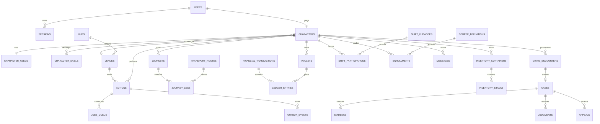

# Lisboa Viva backend feature and schema plan

**Status:** Planning baseline  
**Target stack:** Go modular monolith, PostgreSQL, versioned HTTP API, WebSockets  
**Scope source:** Lisboa Viva master build brief  
**Current repository note:** `main` contains the client-only ROAM pilot. The historical `develop` branch contains an earlier Go/PostgreSQL first-playable backend that can be selectively restored. Do not merge its schema unchanged.

## 1. Backend ownership

The Go service is authoritative for authentication, authorization, characters, location, time, needs, actions, transport, money, inventory, jobs, education, housing, social systems, crime, justice, moderation, and administrative changes. The browser renders state and submits intentions; it never proves completion, balance, ownership, location, or eligibility.

PostgreSQL is the source of truth. Background work uses a PostgreSQL-backed job queue and transactional outbox. Redis is not required initially.

## 2. Delivery priorities

- **P0 — platform foundation:** required before gameplay data is trusted.
- **P1 — first playable:** required by the master brief's acceptance journey.
- **P2 — second release:** deeper social, trade, rental, career, business, and player-role systems.
- **P3 — later:** metropolitan expansion and advanced careers, ownership, vehicles, and civil cases.

Create migrations only for the active milestone. The P2 and P3 entities below define boundaries and relationships, not a request to create every table now.

## 3. Complete backend feature inventory

### 3.1 Platform, API, and operations — P0

- Versioned HTTP API with an OpenAPI contract and generated TypeScript types.
- Consistent request validation, typed domain errors, pagination, filtering, and request IDs.
- Secure password hashing and server-managed sessions with expiry and revocation.
- CSRF protection where cookie authentication requires it, WebSocket origin validation, and rate limiting.
- Role-based authorization for players, moderators, content editors, and administrators.
- Idempotency keys for every command that spends or grants value or completes an action.
- PostgreSQL migrations, repeatable development seeds, isolated test fixtures, and configuration validation.
- Transactional outbox for WebSocket notifications and other post-commit work.
- PostgreSQL-backed jobs with safe claiming, leases, retries, dead-letter handling, and duplicate prevention.
- Structured logs, audit trails, readiness/liveness checks, metrics, backup guidance, and graceful shutdown.
- Docker Compose development environment and demo accounts.
- UTC storage, `Europe/Lisbon` display conversion, and injectable clock/random providers for tests.
- Privacy controls, retention jobs, account export, and account deletion/anonymization workflow.

### 3.2 Accounts and player settings — P0/P1

- Account registration, login, logout, session refresh, session listing, and session revocation.
- Unique normalized game handle used for player lookup and transfers.
- Account status: active, suspended, banned, deletion pending.
- Preferred locale with `pt-PT` as the first-launch default and `en` as an option.
- Accessibility, sound, message-permission, presence-visibility, and risk-mode preferences.
- Terms/privacy acceptance versions and minimum-age eligibility when social play opens.
- Admin roles are separate from in-world police and judicial roles.

### 3.3 Character and progression — P1

- One active adult character per account initially; preserve room for multiple characters later.
- Name, pronouns, biography, appearance, clothing, interests, football allegiance, and starting story.
- Authoritative current venue/location and current journey/action references.
- Needs: energy, hunger, hygiene, mood, health, and social connection.
- Explicit offline decay caps so absence cannot create irreversible loss.
- Skills with experience and level: fitness, football, surfing, cooking, music, DJing, creativity, technical work, repair, customer service, negotiation, and street awareness.
- Separate professional reputation, neighborhood trust, relationships, and criminal heat.
- Newcomer protection, risk eligibility, temporary restrictions, and status effects.
- Server-owned progression grants with provenance and exact-once application.

### 3.4 World and authored content — P0/P1

- Regions, municipalities, hubs, venues, venue entrances, and map coordinates.
- Venue type, capacity, opening windows including cross-midnight periods, entry rules, transport access, and art reference.
- Activities stored as versioned definitions with prerequisites, duration, cost, outcome, cooldown, cancellation policy, and concurrency rules.
- NPC identities, occupations, traits, schedules, dialogue/content keys, relationships, and limited interaction memory.
- Content versioning, draft/published/retired state, effective dates, and editor attribution.
- Separate research sources and review dates from fictional prices, schedules, and mechanics.
- Localized content keys with complete `pt-PT`; English may fall back to Portuguese.
- First-playable seeds for about 10 connected hubs and at least 20 usable venues.

### 3.5 Simulation clock, weather, and calendar — P1

- Persistent configurable game clock distinct from real-time cooldowns and protections.
- Day/night and simulated seasonal calendar.
- Weather, Atlantic wind, heat, rain, surf conditions, and occasional service modifiers.
- Recurring and one-off world events, venue openings, match days, nightlife, and festival windows.
- Scheduled processing that survives restarts and never applies the same tick or reward twice.

### 3.6 Durable actions and state machines — P0/P1

- Generic action lifecycle: pending, running, completed, cancelled, or failed.
- Prerequisite snapshot, location, start/deadline, real or game-clock basis, cost reservation, result, and failure code.
- One mutually exclusive active action per character, with separately modelled passive effects.
- Cancellation and interruption rules, including disconnect-safe completion.
- Worker claiming, retry, timeout recovery, and exact-once effects.
- Action receipts and audit events visible to authorized participants.
- Initial action kinds: work shift, travel, eat, rest, exercise, club activity, stadium activity, beach/surf activity, study session, quest step, and justice/community service step.

### 3.7 Transport and location — P1

- Stops, routes, ordered route stops, service patterns, departure windows, travel modes, fares, transfers, and pass eligibility.
- Walking links and last-mile connections; hill, stairs, rain, and carried-weight modifiers.
- Route search ordered by time, cost, and convenience.
- Journey quote followed by a server-created journey with origin, destination, legs, fare, and arrival time.
- Funds charged or reserved atomically when the journey starts.
- Character location changes only when the final leg completes.
- Disruptions, missed departures, cancellation/refund policy, and late-night alternatives.
- P1 network: walking, bus/tram, Metro, suburban train, and ferry, including Cais do Sodré–Cacilhas and the rail corridor to Carcavelos.
- Later: shared bikes, taxis, scooters, private vehicles, parking, and recreational boats.

### 3.8 Money, banking, and ledger — P0/P1

- Integer-cent virtual euros only; no real-money redemption or banking integration.
- Carried-cash and bank wallets per character, plus named system wallets.
- Double-entry balanced ledger for every value movement.
- Atomic deposits, withdrawals, wages, rent, purchases, tickets, fines, restitution, marketplace settlement, and admin corrections.
- Offline player-to-player transfers by unique handle with identity review, optional note, receipt, and inbox delivery.
- Transaction history restricted to authorized participants.
- Idempotent command processing and concurrency-safe balance checks.
- Configured source/sink categories and initial balance assumptions.
- Split bills and transfer requests later; a request never authorizes withdrawal.
- Suspicious-transfer signals and operational review without silently rewriting balances.

### 3.9 Items, inventory, and trading — P1/P2

- Versioned item definitions, stack limits, weight, durability, effects, protection flags, and localization.
- Inventory containers for carried items, home storage, equipped items, business stock, and escrow.
- Ownership history for unique items and provenance for grants.
- Atomic purchase, consumption, equipment, repair, transfer, reservation, and removal.
- P1 food/grocery purchase and consumption, surf rental, tickets, and protected quest items.
- P2 marketplace listings, expiry, cancellation, fees, reserved stock, two-party secure exchange, and simultaneous money/goods settlement.

### 3.10 Needs, food, fitness, and recovery — P1

- Need decay and recovery formulas with explicit online/offline limits.
- Food effects, meal preparation recipes, ingredients, servings, and shared meals.
- Home rest, hygiene, laundry, exercise, injury/health modifiers, and recovery.
- Gym memberships, individual routines, trainers/classes later, and outdoor alternatives.
- Server validation prevents impossible overlapping activities or effects outside the player's location.

### 3.11 Jobs, careers, and work — P1/P2

- Job definitions, workplace, requirements, availability, contract type, pay, skill gain, and career progression.
- Shift instances, reservations/capacity, attendance, active choices, completion, wage settlement, and receipts.
- P1 at least four complete short jobs supported by NPC employers/customers.
- Starter work and financial recovery path always remain available.
- Applications, referrals, internships, freelance commissions, contracts, and invoices in later milestones.
- Professional contacts and career ladders driven by qualifications, skills, and professional reputation.

### 3.12 Education and qualifications — P1/P2

- Schools/campuses, courses, sessions, prerequisites, costs, schedules, capacity, and instructors.
- Application, admission, enrollment, attendance, practical assignment, assessment attempt, result, and completion.
- Exact-once qualification issuance tied to authenticated course completion.
- Scholarships, tutoring, study groups, apprenticeships, libraries, canteens, associations, and campus events later.
- P1 one short useful course with NPC instruction and flexible sessions.
- Player teachers later use bounded course definitions and cannot alter credentials or assessment history.

### 3.13 Housing and domestic life — P1/P2/P3

- Housing units, rooms, neighborhood, quality attributes, occupancy, storage, kitchen, and rent configuration.
- P1 assigned starting room/home, home rest, storage, cooking, and return-home behavior.
- P2 listings, applications, tenancies, deposits, rent schedules, shared expenses, housemates, guests, utilities, repairs, laundry, and furniture.
- Exact-once billing with offline caps, grace/recovery rules, and auditable payments.
- P3 ownership, mortgages only if later approved, improvements, and condominium maintenance.

### 3.14 Activities, quests, and live events — P1/P2

- Data-driven activity definitions and versioned outcomes.
- Quest chains, prerequisites, branches, objectives, progress, expiry, and exact-once rewards.
- One small P1 NPC quest chain plus gym, club, stadium, and beach/surf activities.
- Event calendar, capacity, tickets, attendance, group invitation, and reward processing.
- Later Santos Populares preparation, football groups, music performances, workshops, community projects, and seasonal jobs.

### 3.15 Presence, chat, relationships, and groups — P1/P2

- Online presence with heartbeat/expiry and clear separation between humans and NPCs.
- Venue membership derived from authoritative location; moving venues changes the local chat subscription.
- Durable venue chat and direct messages with stable IDs, timestamps, idempotent sends, unread markers, and reconnect recovery.
- Offline delivery for permitted direct messages.
- Message permission settings, block, mute, spam limits, and report actions.
- WebSocket connection authorization, room authorization, event sequence/cursor, missed-event replay, and snapshot refresh.
- P2 friendships, friend requests, reciprocal romance, relationship state, invitations, groups, memberships, roles, group chat, crews, teams, and associations.
- Private messages remain inaccessible to in-world police and judicial roles.

### 3.16 Crime and robbery — P1/P2

- Opt-in risk mode and encounter eligibility using authoritative co-location.
- Safe areas, newcomer protection, participant state, cooldowns, victim protection windows, and pair cooldowns.
- NPC crime alternative for criminal progression.
- Abstract choices and server-generated outcome using skills, needs/fatigue, awareness, and heat.
- Configurable loss rule beginning at 10% of carried cash capped at EUR 100.
- Bank funds, homes, equipped essentials, and protected quest items cannot be stolen.
- Encounter resolution and any cash movement happen in one transaction.
- Disconnect-safe state, receipts for both parties, anti-farming rules, and suspicious-coordination signals.
- Consequences: heat, capped fine, brief detention, lost earnings, or community service without debt spirals.

### 3.17 Justice, policing, and appeals — P1/P2/P3

- P1 NPC incident-to-decision lifecycle: incident, report, authenticated evidence, investigation/review, charge or dismissal, hearing/automated appointment, judgment, and appeal.
- Case visibility restricted by participant and role.
- Evidence can only originate from authenticated game events or designated investigation activities.
- Warnings, restitution, capped fines, bounded detention, temporary activity restrictions, and community service.
- Offline-safe detention expiry and NPC fallback so human staffing never blocks release or recovery.
- Immutable logs for searches, seizures, fines, restitution, evidence, and decisions.
- P2 academy, training, duty assignments, supervised patrol/investigation, lawyer, prosecutor, and court-clerk careers with NPC judges.
- P3 bounded player judges, conflict checks, independent appeal, and auditable civil disputes.
- In-world authority never grants account moderation, arbitrary wallet access, or private-message access.

### 3.18 Businesses and player economy — P2/P3

- Business entity, ownership, venue lease, permits as fictional game rules, operating balance, opening schedule, and status.
- Product/service catalog, stock, suppliers, pricing bounds, bookings/orders, staffing, wages, rent, and operating costs.
- One complete P2 small-business loop before adding more business types.
- Insolvency/recovery rules prevent businesses from promising wages they cannot pay.
- Later cafés, repair shops, stalls, studios, gyms, surf schools, and music venues.

### 3.19 Notifications and inbox — P1

- Durable inbox for transfer receipts, direct messages, action completion, course results, journey arrival, case notices, bills, invitations, and system announcements.
- Read/unread state, notification preferences, localization key and parameters, deep-link target, and expiry where appropriate.
- Outbox-to-WebSocket delivery with polling fallback and reconnect recovery.

### 3.20 Moderation, support, content administration, and audit — P0/P1/P2

- Separate user-safety reports from fictional crime reports/cases.
- Report intake, evidence references, queue state, assignment, moderator notes, decision, and appeal/review.
- Player lookup, session/account status, blocks, message metadata access under policy, and bounded moderation actions.
- P1 admin controls for reports, venue/activity settings, and audited balance corrections through ledger adjustments.
- Content draft, preview, validation, publication, retirement, and rollback.
- Immutable audit record for privileged access and mutations.
- Rate-limit and abuse signals, but no hidden game punishment from moderation data.

### 3.21 Analytics and balancing — P1/P2

- Privacy-conscious gameplay events for onboarding, action starts/completions/failures, economy sources/sinks, route use, and progression bottlenecks.
- Economy dashboards from ledger categories rather than duplicated counters.
- Balance configuration versions attached to actions and outcomes for reproducibility.
- Exclude private message content and sensitive precise travel details from general analytics.

## 4. P0/P1 relational schema boundary

The first active schema should cover these tables or equivalent aggregates. Names are provisional but relationships and integrity rules are required.

| Domain | Initial tables | Key integrity rules |
| --- | --- | --- |
| Identity | `users`, `password_credentials`, `sessions`, `user_roles`, `user_settings`, `terms_acceptances` | Normalized handle unique; sessions hashed, expiring, revocable; admin roles separate from game roles. |
| Character | `characters`, `character_appearance`, `character_interests`, `character_needs`, `skill_definitions`, `character_skills`, `reputation_accounts`, `status_effects` | Needs bounded; one active character per user initially; grants carry provenance. |
| World | `regions`, `hubs`, `venues`, `venue_opening_windows`, `venue_rules`, `npc_definitions`, `npc_schedules`, `research_sources`, `content_versions` | Stable IDs; valid coordinates; opening windows support midnight crossing; published content immutable by version. |
| Simulation | `game_clock`, `weather_periods`, `world_events`, `balance_versions` | One authoritative active clock/config; event application idempotent. |
| Actions | `action_definitions`, `actions`, `action_effects`, `cooldowns`, `idempotency_requests`, `jobs_queue`, `outbox_events` | One exclusive running action per character; due-job claims leased; effects and completion commit together. |
| Transport | `transport_stops`, `transport_routes`, `route_stops`, `service_windows`, `walking_links`, `fare_products`, `journeys`, `journey_legs` | Stops ordered per route; final location changes only on completed journey; fare settlement atomic. |
| Economy | `wallets`, `financial_transactions`, `ledger_entries` | Amounts are bigint cents; user wallets nonnegative; each transaction balances to zero; idempotency key unique per actor. |
| Items | `item_definitions`, `inventory_containers`, `inventory_stacks`, `item_instances`, `item_movements` | Quantity nonnegative; unique item has one owner/container; movement and payment settle together. |
| Jobs | `job_definitions`, `job_requirements`, `shift_templates`, `shift_instances`, `shift_participations` | Workplace/location required; one completion and wage per participation. |
| Education | `schools`, `course_definitions`, `course_sessions`, `enrollments`, `assessment_attempts`, `qualification_definitions`, `character_qualifications` | Qualification unique per character/definition; completion transaction grants once. |
| Housing | `housing_units`, `rooms`, `occupancies` | One primary occupied room per character; venue/home link valid. |
| Quests | `quest_definitions`, `quest_steps`, `quest_instances`, `quest_progress`, `reward_grants` | Reward grant unique by source and character. |
| Social | `presence`, `messages`, `conversation_members`, `message_receipts`, `blocks`, `mutes` | Direct-message authorization checked on send and read; room membership derives from location; client message ID deduplicates. |
| Crime | `crime_encounters`, `encounter_choices`, `encounter_outcomes`, `protection_windows` | Participants distinct and co-located; one resolution; cash result and outcome commit together. |
| Justice | `cases`, `case_participants`, `evidence`, `case_events`, `hearings`, `judgments`, `appeals`, `detentions`, `community_service_assignments` | Evidence source authenticated; decision append-only; detention has bounded release time. |
| Operations | `notifications`, `moderation_reports`, `moderation_actions`, `audit_events`, `runtime_settings` | Privileged changes audited; balance correction references a ledger transaction. |

## 5. Core relationship map

## 6. Cross-domain invariants

1. A character has exactly one authoritative location: a venue, an active journey, or a bounded transitional state.
2. A character cannot start mutually exclusive actions while travelling, detained, or already performing one.
3. Browser time, animation, and client balances never complete an action or authorize a spend.
4. Every money movement is integer cents, balanced, atomic, attributable, and idempotent.
5. Inventory ownership and related payment change in the same transaction.
6. A reward, wage, qualification, journey arrival, judgment, or robbery outcome is applied at most once.
7. WebSocket delivery happens after commit; reconnects recover by event cursor or fresh snapshot.
8. Published definitions are versioned so an in-progress action retains the rules it started with.
9. Private chat authorization and account moderation never derive from in-world professions.
10. Real-time cooldowns, protections, and detention expiry remain separate from accelerated game time.
11. All durable timestamps are UTC; localization occurs at the boundary.
12. Player-facing errors expose stable codes and localized messages, never raw database errors.

## 7. Recommended implementation order

1. Restore a clean Go service shell, migrations runner, PostgreSQL Compose service, health checks, configuration, and test database support.
2. Implement users, credentials, sessions, settings, characters, hubs, venues, and seeded content.
3. Implement idempotent commands, actions, worker queue, outbox, and WebSocket event cursors.
4. Implement wallets and the balanced ledger; prove concurrent transfers and retry safety with PostgreSQL integration tests.
5. Implement items, needs, food, rest, jobs, and wage settlement.
6. Implement transport graph, journey actions, fares, and arrival handling.
7. Implement the short course and exact-once qualification grant.
8. Implement presence, venue chat, direct messages, offline delivery, blocks, and reconnect recovery.
9. Implement the eligible robbery encounter and atomic outcome.
10. Implement the NPC case, judgment, detention/community service, and appeal loop.
11. Add the authenticated operational screens, reports, audit views, and ledger-based balance correction.
12. Run the complete two-player acceptance journey and server-restart/concurrency boundary tests.

## 8. Legacy backend reuse assessment

The historical `develop` branch already demonstrates several sound primitives:

- `users`, `sessions`, and a unique handle;
- cash/bank/system wallets with balanced ledger entries;
- request idempotency storage;
- durable actions and one-running-action enforcement;
- inventory and qualifications;
- venue/direct messages, blocks, and presence;
- robbery encounters, cases, reports, audit events, outbox events, and runtime settings.

Before reuse, replace opaque text identifiers with consistent stable IDs, split character JSON state into integrity-sensitive relational columns, add explicit content/version tables, normalize locations and journeys, strengthen role and message authorization, and expand the action/outbox/job lifecycle. Preserve the balanced-ledger and idempotency concepts.

## 9. Required backend acceptance tests

- Concurrent spending cannot overdraw cash or bank wallets.
- A transfer retry produces one transaction and one receipt.
- A failed transfer cannot debit only one participant.
- Worker restart cannot duplicate wages, item grants, course completion, or journey arrival.
- A forged location or completion request cannot teleport a character or grant rewards.
- Cross-midnight venue windows and Lisbon timezone display behave correctly.
- Two sessions see presence and venue chat; reconnect recovers missed durable events.
- An offline player receives an authorized direct message and transfer receipt on return.
- Blocks prevent discovery/direct interaction without exposing private data.
- Protected or ineligible players cannot be robbed; an eligible outcome is identical for both parties.
- Robbery cash movement and encounter resolution are one atomic commit.
- Evidence cannot be fabricated through roleplay text or client fields.
- Police/judicial game roles cannot read unrelated messages, alter balances, or moderate accounts.
- Detention expires while offline and appeal cannot apply the original judgment twice.
- Admin balance correction creates an auditable balanced-ledger adjustment.

